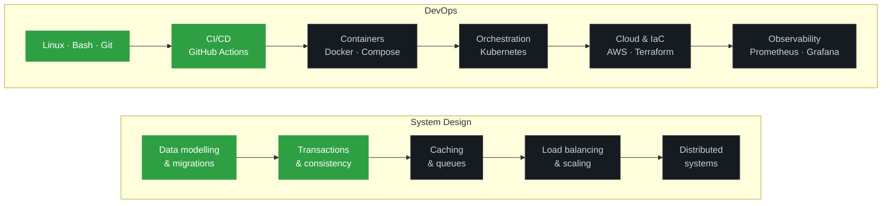

<!-- Uncomment and fill in your links:

-->

---

### 👋 About me

I'm a 5th-semester **Computer Science** student at **FAST NUCES, Lahore**, working on **DevOps** and **system design & architecture**: how software is structured, how its data stays consistent, and how it gets built, shipped and run reliably.

I've built desktop apps, web platforms and data pipelines end to end. The work I enjoy most is the design underneath them and the automation around them.

- 🎯 **Looking for:** DevOps, platform or backend/infrastructure internships
- 🏆 Competed in the **AIEF 4th International AI Championship** (AI in Fintech)

---

### 🏗️ System design in my projects

| | Design decision | Where |
|:---:|---|---|
| 🧱 | **Layered, defence-in-depth architecture:** designed four independent checks (camera, challenge-response, signal analysis, identity match) feeding one risk-decision layer, so no single check is a point of failure | [PulseGuard](https://github.com/fast-na-ana/pulseguard) |
| 📚 | **Append-only ledger:** double-entry posting where posted lines are immutable and corrections are reversing entries, with balance enforced per transaction | [Bloc](https://github.com/fast-na-ana/bloc) |
| 🧩 | **Layered service architecture:** routes → controllers → services → data layer, with auth, optional-auth and admin middleware for role-based access, and the external movie API isolated behind a rate-limited, cached service | [CineSocial](https://github.com/ofar00q/Cinesocial-Webapp) |
| 🔌 | **Two-process desktop architecture:** a Rust core owns all business logic and the UI talks to it over 36 typed IPC commands, with no HTTP layer | [Bloc](https://github.com/fast-na-ana/bloc) |
| 🔒 | **Transactional consistency:** multi-table writes such as seat booking, invoice posting or premium upgrades commit atomically or roll back fully, so failures leave no orphan rows | [CampusRide](https://github.com/fast-na-ana/campusride) · [Bloc](https://github.com/fast-na-ana/bloc) · [CineSocial](https://github.com/ofar00q/Cinesocial-Webapp) |
| 🧭 | **Clear trust boundaries:** the LLM only parses and normalises text, and all medical range checks run in deterministic code against a versioned knowledge base | [Lab Report Analyzer](https://github.com/fast-na-ana/lab-report-analyzer) |
| 🗃️ | **Data modelling:** normalised relational schemas with views and stored procedures that keep query logic in the database, each with a REST API designed on top | [CampusRide](https://github.com/fast-na-ana/campusride) · [CineSocial](https://github.com/ofar00q/Cinesocial-Webapp) |

### ⚙️ DevOps & automation in my projects

| | What I did | Where |
|:---:|---|---|
| 🗄️ | **Schema as code:** 15 forward-only, versioned migrations applied on startup, guarded by a 24-test suite | [Bloc](https://github.com/fast-na-ana/bloc) |
| 🍴 | **Maintain a downstream fork** of a 3,900-commit open-source app that ships through **GitHub Actions** build, lint, test and publish workflows | [Bloc Books](https://github.com/fast-na-ana/bloc-books) |
| 🔁 | **Restartable, parallel batch pipeline:** 2,587 inputs processed on a worker pool with cached stages and per-item status logs, so a multi-hour job can stop and resume safely | [PulseGuard](https://github.com/fast-na-ana/pulseguard) |
| 🛠️ | **Scripted environment provisioning:** one script creates the database, loads the schema and seed data, and another installs every dependency | [CampusRide](https://github.com/fast-na-ana/campusride) |
| 🔑 | **Config through environment variables:** secrets kept out of code, with `.env.example` templates checked in | [Lab Report Analyzer](https://github.com/fast-na-ana/lab-report-analyzer) · [CampusRide](https://github.com/fast-na-ana/campusride) |
| 📦 | **Portable build artifacts:** model exported to ONNX with a config sidecar, so it runs fully offline on the target machine | [PulseGuard](https://github.com/fast-na-ana/pulseguard) |

---

### ⭐ Featured projects

<table>
<tr>
<td width="50%" valign="top">
<h4>📒 <a href="https://github.com/fast-na-ana/bloc">Bloc</a></h4>

Offline desktop accounting system. A Rust core behind typed IPC, an append-only <b>double-entry ledger</b>, transactional posting, versioned migrations, money as integer paisa and a <b>24-test</b> accounting suite.

<code>Rust</code> <code>Tauri</code> <code>React</code> <code>TypeScript</code> <code>SQLite</code>

</td>
<td width="50%" valign="top">
<h4>🎬 <a href="https://github.com/ofar00q/Cinesocial-Webapp">CineSocial</a> team project</h4>

A social platform for rating and discussing films. Built as a layered Express backend with <b>11 REST modules</b>, role-based auth middleware, a rate-limited and cached <b>TMDB</b> integration service, and a SQL Server data layer of views, stored procedures and transactional workflows. I was the top committer, including the architecture refactor.

<code>React</code> <code>Express</code> <code>SQL Server</code> <code>JWT</code> <code>REST</code>

</td>
</tr>
<tr>
<td width="50%" valign="top">
<h4>🫀 <a href="https://github.com/fast-na-ana/pulseguard">PulseGuard</a></h4>

A layered deepfake firewall for remote KYC, designed as four independent checks feeding one risk decision, and backed by a restartable data pipeline over <b>15k+ video windows</b> and a model packaged for <b>offline deployment</b>.

<code>Python</code> <code>PyTorch</code> <code>OpenCV</code> <code>ONNX</code>

</td>
<td width="50%" valign="top">
<h4>🚗 <a href="https://github.com/fast-na-ana/campusride">CampusRide</a></h4>

Three-tier carpooling platform: a 14-table SQL Server schema, an Express REST API with JWT auth and transactional seat booking, a React frontend, and scripted database provisioning.

<code>Node.js</code> <code>Express</code> <code>SQL Server</code> <code>React</code> <code>PowerShell</code>

</td>
</tr>
<tr>
<td width="50%" valign="top">
<h4>📗 <a href="https://github.com/fast-na-ana/bloc-books">Bloc Books</a></h4>

A customised, fully offline build of the open-source Frappe Books. I removed the network dependencies (telemetry, updater, sync) and added credit control, payment verification and keyboard-first entry. About <b>30 commits across 240+ files</b>.

<code>TypeScript</code> <code>Vue 3</code> <code>Electron</code> <code>GitHub Actions</code>

</td>
<td width="50%" valign="top">
<h4>🩺 <a href="https://github.com/fast-na-ana/lab-report-analyzer">Lab Report Analyzer</a></h4>

Lab-report analysis with a strict boundary: an LLM parses PDFs, and a deterministic engine checks values against a 125-test knowledge base, so the numbers can't be hallucinated. Supports Urdu, Punjabi and voice.

<code>Python</code> <code>Streamlit</code> <code>Groq / Llama 3.3</code>

</td>
</tr>
</table>

---

### 🛠️ Tech stack

**DevOps & tooling**
 

**Languages**
 

**Backend, apps & data**
 

**Also worked with**
 

---

### 🧭 What I'm working on

🟩 using in my projects · ⬛ learning next

---

